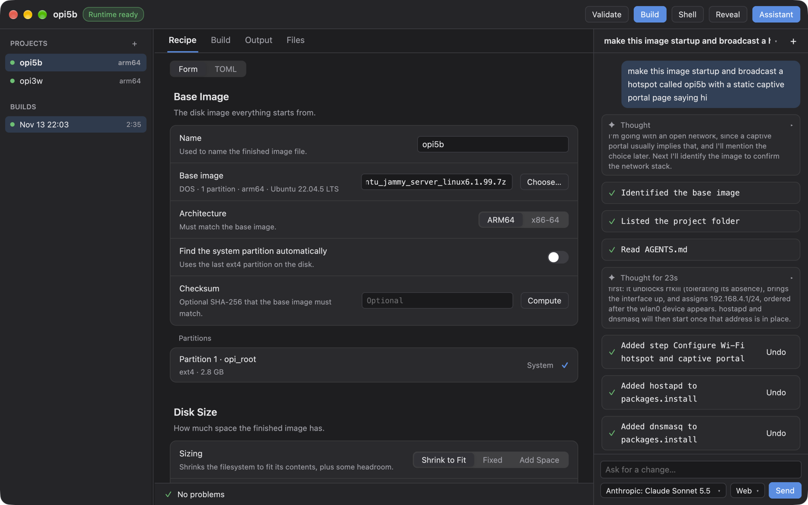

# ImageSmith



Customize Linux disk images from a declarative recipe — natively on your Mac.

[Download for macOS](https://github.com/syousif94/imagesmith/releases/latest/download/ImageSmith.dmg) · Requires macOS 26 on Apple silicon

## Features

- **Declarative recipes** — describe packages, files, users and services once; rebuild the same image every time.
- **Native builds** — images are built in a lightweight Linux container, no VM to manage.
- **Built-in assistant** — ask it to edit your recipe, explain build output, or fix failures (OpenRouter or LM Studio).
- **Files & terminal** — browse the image filesystem and open a shell inside it before you ship.
- **Flash to disk** — write the finished image straight to an SD card or USB drive.
- **CLI included** — the `imagesmith` command line tool ships inside the app for scripting and CI.

## Recipe

Each project is a folder with a `recipe.toml`:

```toml
[image]
name = "rk3588-edge"
base = "bases/armbian-rk3588.img.xz"
arch = "arm64"
rootfs_partition = 2

[size]
mode = "shrink"
headroom = "15%"
expand_on_boot = true

[system]
hostname = "edge-01"
timezone = "America/Los_Angeles"

[[users]]
name = "sammy"
groups = ["sudo", "dialout"]
ssh_keys = ["~/.ssh/id_ed25519.pub"]

[packages]
install = ["htop", "can-utils", "python3-venv"]
remove = ["unattended-upgrades"]

[services]
enable = ["ssh"]

[[files]]
src = "files/app.service"
dst = "/etc/systemd/system/app.service"
mode = "0644"

[[steps]]
name = "Restore ping caps"
run = "setcap cap_net_raw+ep /usr/bin/ping"

[output]
compress = "zstd"
```

## CLI

```sh
imagesmith runtime setup               # build the builder image and store container
imagesmith init my-image --base base.img.xz   # create a project with a starter recipe
imagesmith validate my-image
imagesmith build my-image
imagesmith flash my-image --list       # list candidate devices
imagesmith shell my-image              # shell into the project's stage
```

Run `imagesmith --help` for all commands.

## Building from source

```sh
cargo build --release
bundle/make-app.sh --dmg   # → target/release/ImageSmith.app
```

Layout:

- `crates/imagesmith-core` — recipe, validation, build orchestration, store, flashing
- `crates/imagesmith-cli` — `imagesmith` command line tool
- `crates/imagesmith-app` — macOS app (gpui)
- `builder/` — container image and build script that run inside the Linux container
- `bundle/` — app bundle and DMG packaging

## License

[MIT](LICENSE)
